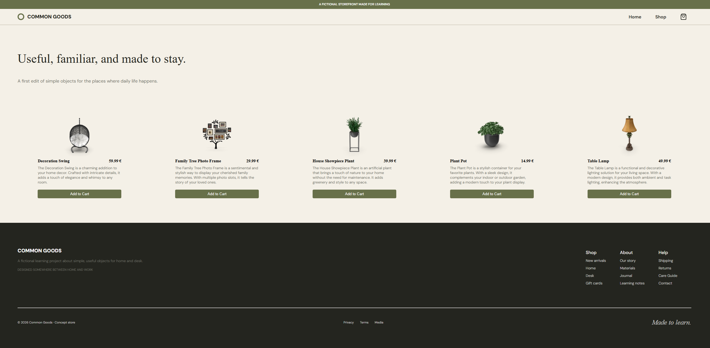
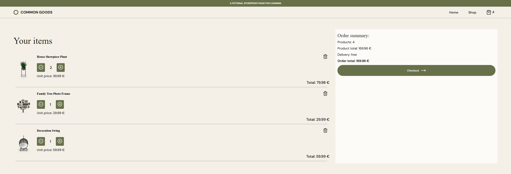

# Common Goods – Mock Shopping Cart

A fictional storefront built to practice React. Browse products, add them to a cart, adjust quantities, and see the cart update live in the navigation bar.

**Live demo:** <!-- TODO: add Netlify URL -->

> This is a learning project. The shop is fictional and the checkout is a mock: nothing is purchased, and the cart intentionally resets on reload.




## Features

- **Home page** with a hero section (images and information)
- **Shop page** with a product card per item: image, name, price and "Add to cart". After adding, the card switches to increment/decrement buttons. Includes a loading state and an error message if the fetch fails
- **Cart page** listing the cart items, each with increment, decrement and remove buttons, plus an order summary and an empty-cart state
- **Navigation bar** with links to all pages and a cart icon whose item count updates in real time
- **Responsive**, mobile-first layout

## Tech stack

| Purpose              | Tool                                                                                        |
| -------------------- | ------------------------------------------------------------------------------------------- |
| UI                   | React                                                                                       |
| Routing              | React Router                                                                                |
| Build and dev server | Vite                                                                                        |
| Styling              | styled-components (theme + global styles)                                                   |
| Icons                | lucide-react                                                                                |
| Testing              | Vitest and React Testing Library                                                            |
| Product data         | [DummyJSON](https://dummyjson.com/)                                                         |
| Hosting              | Netlify                                                                                     |
| Fonts                | 'Cormorant Garamond' (serif), 'DM Sans Variable' (sans-serif) - self-hosted with Fontsource |

I also used Trello as project management tool.

## Getting started

```bash
git clone https://github.com/<your-username>/mock-shopping-cart.git
cd mock-shopping-cart
npm install
npm run dev
```

Other scripts:

```bash
npm test           # run the tests (adjust if your script name differs)
npm run build      # production build
npm run preview    # preview the production build locally
```

## Project structure

```
src/
  components/   CartItem, FeaturedCard, Footer, Navbar, ProductCard
  pages/        HomePage, ShopPage, CartPage
  context/      CartContext (provider + context)
  utils/        cartLogic (pure cart functions), fetchItems (API call)
  styles/       theme and global styles
  assets/       images
  App.jsx       layout route: Navbar + <Outlet />, wrapped in CartProvider
  main.jsx      router setup
tests/          mirrors src/ (components, utils)
```

## Design decisions

**Cart state shape.** The cart is an array of `{ id, title, price, thumbnail, quantity }`. Total price and item count are _derived_ from the array instead of stored, so they can never get out of sync with the items.

**Cart logic is separate from React.** `addItem`, `removeFromCart`, `incrementItem` and `decrementItem` are pure functions that take a cart and return a new one, without mutating the original. The context provider only wires them to `useState` (`setCart((prev) => ...)`). This made the logic easy to unit test without rendering anything.

**Behavior rules.**

- Adding a product that is already in the cart increases its quantity instead of creating a duplicate row
- Decrementing at quantity 1 removes the item (the product card switches back to "Add to cart")
- Removing deletes the item regardless of quantity
- Prices are formatted only when displayed (`toFixed(2)`)

**Error handling.** `fetchItems` throws on a failed request. `ShopPage` catches the error and decides what to show, so the utility stays free of UI concerns.

**Routing.** A layout route (`App.jsx`) renders the navigation bar and an `<Outlet />`, so the navbar appears on every page.

**Styling.** Colors, fonts and breakpoints live in one theme object, provided with `ThemeProvider`. Global resets and base styles are in `createGlobalStyle`. Layouts are written mobile-first with `min-width` media queries.

## Testing

- **Cart logic:** every function is tested with plain arrays, including edge cases and a check that the input cart is not mutated
- **`fetchItems`:** tested with a mocked `fetch` (success, HTTP error, network failure)

## Challenges and what I learned

- **API outage.** The original FakeStore API went down (Cloudflare 523), and the browser reported it as a CORS error. Reading the status code in the Network tab revealed the real cause. I switched to DummyJSON, and because the fetch lives in one util, only that file and the field names changed
- **File name casing on Windows.** A wrongly cased import path caused confusing errors that cached tooling kept showing. Matching imports to exact file names matters because Netlify builds on Linux
- **State and immutability.** Building the cart logic as pure functions showed me why React state updates must return new arrays and why the `prev =>` form is safer
- **Single-page app hosting.** Routes like `/cart` need a redirect rule on Netlify, otherwise refreshing the page gives a 404
- **Project management.** This is the biggest React project I have made, so I needed a well structured project management plan to go with. I used Trello and build a simple board with tasks.

## Deployment

Hosted on Netlify. To support client-side routing, `public/_redirects` contains:

```
/*  /index.html  200
```

<!-- TODO: confirm the file exists and that refreshing /shop and /cart works on the live site -->

## Possible improvements

- Persist the cart (for example in `localStorage`)
- A real checkout flow
- Product search, filtering and a product detail page
- More component tests (ProductCard, Navbar, pages)
- Accessibility pass (keyboard navigation, focus states)

## Credits

- Product data: [DummyJSON](https://dummyjson.com/)
- Icons: [Lucide](https://lucide.dev/)
- Hero image: [Pixabay](https://pixabay.com/fi/photos/huonekalut-p%C3%B6yt%C3%A4-tuolit-sis%C3%A4kasveja-1840463/) Profile name: [Pexels](https://pixabay.com/fi/users/pexels-2286921/)
- Built as part of [The Odin Project](https://www.theodinproject.com/) React path

## How I used AI

I used Claude AI throughout this project. It helped me understand theory and explained concepts I was encountering for the first time. It reviewed my code and gave feedback on how to improve it to a more professional and accessible level. Claude also generated the initial draft of this README based on our conversations during the project.
